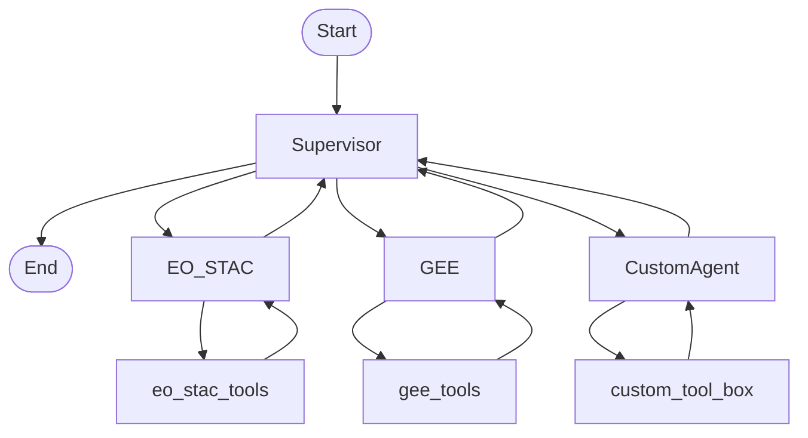

# Agentic EO Ecosystems

This project explores the integration of **EVE (Earth Virtual Expert)**, a Large Language Model specialized in **Earth Observation (EO)** and Earth Sciences, developed under ESA’s **Φ-lab #AI4EO initiative** in collaboration with Pi School.  

The primary goal is to enable EVE to connect ESA’s EO platforms and data clusters, creating an **integrated ecosystem for the EO community**. This approach leverages **agentic capabilities**, allowing EVE to dynamically interact with EO tools, databases, and APIs to reason and act autonomously.

## ToDo's
1. Move definitions.py into agenticeoecosystem package
2. Use EVE as LLM instead of mistral
3. Improve system prompt so gives more user-friendly output
4. Allow for follow up questions in agentic tab 
5. Make interface more intuitive 
6. Make Eve work with Ollama / Vllm
7. Exploring multi-agent approaches

## Overview

To demonstrate this concept, we present a **proof-of-concept use case** where EVE operates within an agentic framework to interact with the **[EO Dashboard](https://eodashboard.org/)** which is a joint initiative by ESA, NASA, and JAXA that provides global indicators and narratives derived from multi-mission EO data.

Using the **[MCP protocol](https://modelcontextprotocol.io/)**, this work enables dynamic connectivity between EVE and the Dashboard, allowing the model to:

- Interpret and summarize narratives
- Extend insights with additional context
- Facilitate advanced information retrieval across datasets and stories

The study also explores **early-stage agentic behaviors**, such as autonomous task chaining, enabling EVE to perform multi-step reasoning. For example, EVE can interpret quantitative trends in dashboard indicators (e.g., air quality changes, greenhouse gas concentrations, land cover dynamics), link these to underlying datasets, and generate scientifically grounded responses.

This proof-of-concept demonstrates EVE’s potential to **foster interoperability** and **accelerate Earth system science** by improving knowledge accessibility and enabling more effective use of EO data resources.


### Requirements
- Python 3.12+

### Installation
Clone the repository:
```
git clone https://gitlab.esa.int/PhiLab/internal/agenticeoecosystem.git
cd agentic-eo-ecosystems
uv sync
uv pip install -e .
```

#### Option 1: Using uv (recommended)
Install uv if it is not installed:
```bash
curl -LsSf https://astral.sh/uv/install.sh | sh
```

Restart shell and verify:
```bash
uv --version
```

Install project dependencies:
```bash
uv sync
```

#### Option 2: Without uv (standard pip)
Create and activate a virtual environment:
```
python -m venv .venv
source .venv/bin/activate
```

Install dependencies:
```
pip install .
```
#### Option 3: With Conda
Create and activate a virtual environment with conda:
```
conda create -n multi_agent python=3.12
conda activate multi_agent
```

Install dependencies:
```
pip install -e .
```

## Workflow



The workflow is a multi-layer approach with the first layer between the supervisor and the agents it is connected to, and the second layer is the tools connected to the respective agents. 

## Adding Custom sub-agents

### Creating the mcp tools
- We will operate under the assumption that you've a set of mcp tools you want to attach to the sub agents.

To create the mcp servers, follow the example server as given in [example_server.py](\src\agenticeoecosystem\servers\example\stdio_localserver\example_server.py) or any other servers in the [servers_folder](src\agenticeoecosystem\servers). Once created make sure to add this object to the `MCP_SERVERS` variable in the [mcp_config.py](src\agenticeoecosystem\config\mcp_config.py)
```
"example": {
         "transport": "stdio", # or any other transport you'll be using
         "command": "python", # or any other framwork you're using
         "args": [
             f"{ROOT_DIR}/src/agenticeoecosystem/servers/example/stdio_localserver/example_server.py" # or path to you mcp server
         ],
     },

```
[This](https://modelcontextprotocol.io/docs/develop/build-server) is a good place to start if you want to know more about mcp servers in general.

The tools are called using the following line in [client.py](src\agenticeoecosystem\client\client.py)
```
mcp_tools = asyncio.run(load_tools_from_mcp())
```
Make sure to index the tools properly to your custom agent. We will discuss this further in the next section.

<b> KNOWN BUG </b> Currently we hard coded the indices of tools for the the other agents, so make sure you add your server after the existing servers in the `MCP_SERVERS` variable

#### Creating the subagents

First you declare the agent

```
my_custom_agent = create_agent(
    model,
    tools=mcp_tools[index_start:index_end],
    system_prompt=()
)
```

As mentioned in the previous section make sure you have an idea as to where your tools might begin and the others end.

Next, wrap it into a tool

```
@tool
async def my_agent_as_tool(request: str) -> str:
    """Describe the funcionality of the agent"""
    print(f"[TOOL CALL] get_eo_stac_data with request: {request}")

    result = await eo_stac_agent.ainvoke({
        "messages": [{"role": "user", "content": request}]
    })
    text_output = result["messages"][-1].text
    if isinstance(text_output, tuple):
        text_output = " ".join(str(t) for t in text_output)
    print(f"[TOOL RESULT] {text_output}")
    return str(text_output)

```

Finally update the supervisor agent 

```
supervisor_agent = create_agent(
    model,
    tools=[get_eo_stac_data, get_gee_data, my_agent_as_tool],
    system_prompt=(
        "You are a routing agent. "
        "You can get data from EO Dashboards and also Google Earth Engine and STUFF FROM CUSTOME AGENT. "
        "Break down user requests into appropriate tool calls and coordinate the results. "
        "When a request involves multiple actions, use multiple tools in sequence."
    )
)

```

<b> YAYYYYYY </b>, you added your first custom agent!!!!

If you run into any troubles feel free to open an issue and one of the staff members will look at it 😊.
