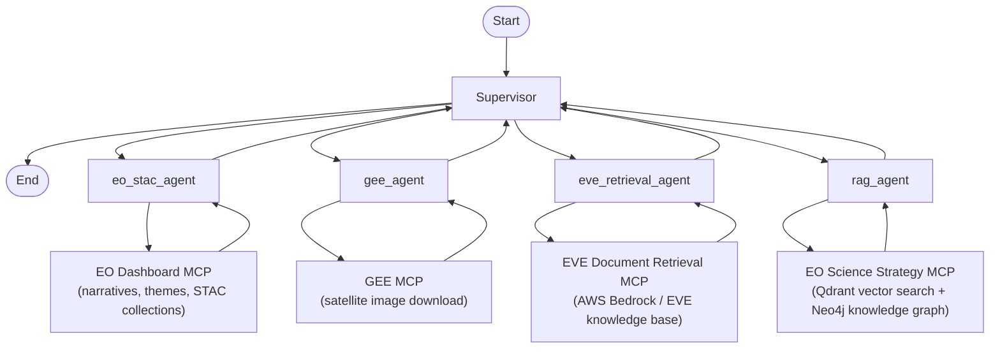

# Agentic EO Ecosystems

This project explores the integration of **EVE (Earth Virtual Expert)**, a Large Language Model specialised in **Earth Observation (EO)** and Earth Sciences, developed under ESA's **Φ-lab #AI4EO initiative** in collaboration with Pi School.

The primary goal is to enable EVE to connect ESA's EO platforms and data clusters, creating an **integrated ecosystem for the EO community**. This approach leverages **agentic capabilities**, allowing EVE to dynamically interact with EO tools, databases, and APIs to reason and act autonomously.

## ToDo's
1. Move definitions.py into agenticeoecosystem package
2. Improve system prompt so gives more user-friendly output
3. Allow for follow up questions in agentic tab
4. Make interface more intuitive
5. Make EVE work with Ollama / vLLM

## Overview

This project implements a **multi-agent supervisor architecture** in which a supervisor routes each user query to one or more specialised agents. Each agent connects to an MCP server:

- **EO Dashboard agent** — browses narratives, themes, and STAC collections from the ESA/NASA/JAXA [EO Dashboard](https://eodashboard.org/)
- **GEE agent** — downloads satellite images via the Google Earth Engine Python API
- **EVE retrieval agent** — retrieves knowledge from the EVE knowledge base (AWS Bedrock)
- **Hybrid RAG agent** — retrieves from the ESA EO Science Strategy via semantic vector search (Qdrant) and a Neo4j knowledge graph

Using the **[MCP protocol](https://modelcontextprotocol.io/)**, agents can perform multi-step reasoning: for example, searching for a narrative, linking it to a STAC collection, and retrieving satellite data for the relevant indicator.

Each session writes a timestamped log to `logs/client_YYYYMMDD_HHMMSS.log`.

## Repository layout

```
AgenticEOEcosystem/
├── agenticeoecosystem/     ← this repo
└── hybridrag_pipeline/     ← separate repo, clone as sibling
```

The `hybridrag_pipeline` repository must be cloned as a sibling directory. If it is absent or its `.env` is incomplete, the Hybrid RAG MCP server is skipped gracefully at startup — the other three servers continue to work.

### Requirements
- Python 3.12+

### Installation
Clone the repository:
```bash
git clone https://gitlab.esa.int/PhiLab/internal/agenticeoecosystem.git
cd agenticeoecosystem
```

#### Option 1: Using uv (recommended)
Install uv if it is not installed:
```bash
curl -LsSf https://astral.sh/uv/install.sh | sh
```

Restart shell and verify:
```bash
uv --version
```

Install dependencies and the local package in one step:
```bash
uv sync
```

Install agenticecosystem package with pip:
```bash
uv pip install -e . --no-deps
```


#### Option 2: Without uv (standard pip)
Create and activate a virtual environment:
```bash
python -m venv .venv
source .venv/bin/activate
```

Install dependencies and the local package:
```bash
pip install -e .
```

#### Option 3: With Conda
Create and activate a virtual environment with conda:
```bash
conda create -n multi_agent python=3.12
conda activate multi_agent
```

Install dependencies and the local package:
```bash
pip install -e .
```

## Running the Client

The main entry point is `src/agenticeoecosystem/client/client.py`. Note that startup takes a few minutes — the MCP servers need to initialise and tool discovery runs at import time. Subsequent queries in the same session are fast.

```bash
cd agenticeoecosystem
python src/agenticeoecosystem/client/client.py
```

By default the client uses **Ollama/Mistral** as the LLM backend. To use **EVE** instead, pass the `--llm eve` flag:

```bash
python src/agenticeoecosystem/client/client.py --llm eve
```

Once loaded, the client enters an interactive loop. Type your query and press Enter. Type `quit` to exit.

```
Query (or 'quit' to exit): Is there a narrative about COVID-19?
```

Each session writes a timestamped log file to `logs/client_YYYYMMDD_HHMMSS.log`.

## Running with Apptainer (recommended on NFS)

On NFS-mounted home directories, Python startup is slow because the OS performs a permission check for every file in `.venv/` (thousands of files). An Apptainer container bundles the entire Python environment into a single `.sif` image file, bypassing this overhead entirely.

### Prerequisites

Apptainer must be installed on the machine (`apptainer --version` to check).

### Build the container (one-time)

Run from the project directory. Set `APPTAINER_TMPDIR` to a location with sufficient disk space (your NFS home is fine):

```bash
export APPTAINER_TMPDIR=/path/to/scratch/tmp
export APPTAINER_CACHEDIR=/path/to/scratch/tmp/apptainer-cache
mkdir -p $APPTAINER_CACHEDIR

cd /path/to/agenticeoecosystem
apptainer build agenticeoecosystem.sif container.def
```

The build takes ~10–20 minutes on first run (downloads and installs all dependencies). The resulting `agenticeoecosystem.sif` is excluded from git via `.gitignore`.

### Run client.py

```bash
apptainer exec \
  --bind /path/to/agenticeoecosystem:/project \
  --bind /path/to/hybridrag_pipeline:/hybridrag_pipeline \
  /path/to/agenticeoecosystem/agenticeoecosystem.sif \
  python /project/src/agenticeoecosystem/client/client.py --llm eve
```

- `--bind .../agenticeoecosystem:/project` mounts your source code live — code changes are reflected immediately, no rebuild needed
- `--bind .../hybridrag_pipeline:/hybridrag_pipeline` is required for the Hybrid RAG MCP server
- No need to activate a virtual environment

### Update dependencies

When `pyproject.toml` changes, update the lock file and rebuild:

```bash
uv lock                                          # update uv.lock locally
apptainer build agenticeoecosystem.sif container.def   # rebuild container
```

Rebuilds are fast because uv caches downloaded packages.

## Workflow



The supervisor routes each user query to one or more specialised agents. Each agent calls its MCP server(s) and returns a synthesised result. The supervisor passes the result through to the user.

## MCP Servers

The client connects to four MCP servers at startup, configured in [`mcp_config.py`](src/agenticeoecosystem/config/mcp_config.py).

### EO Dashboard

No setup required. The server fetches data from public ESA EO Dashboard endpoints and exposes tools for browsing narratives, themes, and STAC collections.

### Google Earth Engine (GEE)

Enables satellite image downloads via the [Earth Engine Python API](https://developers.google.com/earth-engine/guides/python_install). The following one-time setup is required:

1. **Create a Google account** and sign up for [Google Earth Engine](https://earthengine.google.com/). Academic/research access is free.
2. **Create a Google Cloud project** at [console.cloud.google.com](https://console.cloud.google.com) and note the **Project ID**.
3. **Enable the Earth Engine API**: APIs & Services → Enable APIs → search for *Earth Engine API*.
4. **Create a service account**: IAM & Admin → Service Accounts → Create. Assign the role *Earth Engine Resource Writer* (or *Editor*).
5. **Register the service account with Earth Engine**: go to [code.earthengine.google.com/register](https://code.earthengine.google.com/register), select your Cloud project, and complete registration.
6. **Download a JSON key**: Service Accounts → your account → Keys → Add Key → JSON. Save the file somewhere accessible.
7. **Set the following in `.env`**:

```env
GEE_PROJECT=your-gcp-project-id
GEE_SERVICE_ACCOUNT=your-service-account@your-project.iam.gserviceaccount.com
GEE_PRIVATE_KEY_PATH=/absolute/path/to/your-key.json
```

### EVE Knowledge Retrieval

Provides retrieval-augmented access to the EVE knowledge base. Requires OAuth2 credentials from the EVE platform:

```env
EVE_RETRIEVAL_CLIENT_ID=your-client-id
EVE_RETRIEVAL_CLIENT_SECRET=your-client-secret
```

Contact the EVE platform team to obtain these credentials. If they are not set the server is skipped and the `get_eve_knowledge` tool will be unavailable.

### EO Science Strategy (Hybrid RAG)

Provides hybrid retrieval over the **ESA Earth Observation Science Strategy** documents — combining semantic vector search (Qdrant) with a Neo4j knowledge graph that links document chunks to domain concepts (science themes, science questions, strategic objectives, enabling tools, tipping points, treaties).

The RAG pipeline lives in `../hybridrag_pipeline/` (sibling directory, separate repo). Its `.env` must contain:

```env
QDRANT_URL=https://...
QDRANT_KEY=your-qdrant-api-key
QDRANT_COLLECTION=hybridrag_chunks   # optional, this is the default
NEO4J_URI=bolt://localhost:7687
NEO4J_USERNAME=neo4j
NEO4J_PASSWORD=your-neo4j-password
```

**One-time index build** (run from `hybridrag_pipeline/`):

```bash
# 1. Ingest PDFs into Qdrant
python build_qdrant.py

# 2. Build the Neo4j knowledge graph
python build_neo4j.py
```

Once the indexes are built the server starts automatically with the client. If Qdrant or Neo4j are unreachable the tool returns an error string rather than crashing the client.

## MCP Servers

The client connects to three MCP servers at startup, configured in [`mcp_config.py`](src/agenticeoecosystem/config/mcp_config.py).

### EO Dashboard

No setup required. The server fetches data from public ESA EO Dashboard endpoints and exposes tools for browsing narratives, themes, and STAC collections.

### Google Earth Engine (GEE)

Enables satellite image downloads via the [Earth Engine Python API](https://developers.google.com/earth-engine/guides/python_install). The following one-time setup is required:

1. **Create a Google account** and sign up for [Google Earth Engine](https://earthengine.google.com/). Academic/research access is free.
2. **Create a Google Cloud project** at [console.cloud.google.com](https://console.cloud.google.com) and note the **Project ID**.
3. **Enable the Earth Engine API**: APIs & Services → Enable APIs → search for *Earth Engine API*.
4. **Create a service account**: IAM & Admin → Service Accounts → Create. Assign the role *Earth Engine Resource Writer* (or *Editor*).
5. **Register the service account with Earth Engine**: go to [code.earthengine.google.com/register](https://code.earthengine.google.com/register), select your Cloud project, and complete registration.
6. **Download a JSON key**: Service Accounts → your account → Keys → Add Key → JSON. Save the file somewhere accessible.
7. **Set the following in `.env`**:

```env
GEE_PROJECT=your-gcp-project-id
GEE_SERVICE_ACCOUNT=your-service-account@your-project.iam.gserviceaccount.com
GEE_PRIVATE_KEY_PATH=/absolute/path/to/your-key.json
```

### EVE Knowledge Retrieval

Provides retrieval-augmented access to the EVE knowledge base. Requires OAuth2 credentials from the EVE platform:

```env
EVE_RETRIEVAL_CLIENT_ID=your-client-id
EVE_RETRIEVAL_CLIENT_SECRET=your-client-secret
```

Contact the EVE platform team to obtain these credentials. If they are not set the server is skipped and the `get_eve_knowledge` tool will be unavailable.

## Adding Custom sub-agents

### Creating the MCP tools

To create an MCP server, follow the example server at [`src/agenticeoecosystem/servers/example/stdio_localserver/example_server.py`](src/agenticeoecosystem/servers/example/stdio_localserver/example_server.py) or any other server in the [`servers/`](src/agenticeoecosystem/servers) folder. Once created, add an entry to `get_mcp_servers()` in [`mcp_config.py`](src/agenticeoecosystem/config/mcp_config.py):

```python
"example": {
    "transport": "stdio",
    "command": "python",
    "args": [
        f"{ROOT_DIR}/src/agenticeoecosystem/servers/example/stdio_localserver/example_server.py"
    ],
},
```

See the [MCP documentation](https://modelcontextprotocol.io/docs/develop/build-server) for more on building MCP servers.

Tools are loaded at startup via:
```python
mcp_tools = asyncio.run(load_tools_from_mcp())
```

Tools are assigned to agents by name (e.g. `t.name in {"my_tool_a", "my_tool_b"}`), so the order of servers in `get_mcp_servers()` does not matter.

### Creating the sub-agent

Declare the agent:

```python
my_custom_agent = create_agent(
    model,
    tools=[t for t in mcp_tools if t.name in ("my_tool_a", "my_tool_b")],
    system_prompt="..."
)
```

Wrap it as a tool for the supervisor:

```python
@tool
async def my_agent_as_tool(request: str) -> str:
    """Describe the functionality of the agent."""
    logger.info("[TOOL CALL] my_agent_as_tool: %s", request)
    result = await my_custom_agent.ainvoke({
        "messages": [{"role": "user", "content": request}]
    })
    text_output = result["messages"][-1].text
    if isinstance(text_output, tuple):
        text_output = " ".join(str(t) for t in text_output)
    return str(text_output)
```

Register it with the supervisor:

```python
supervisor_agent = create_agent(
    model,
    tools=[get_eo_stac_data, get_gee_data, get_eve_knowledge, get_hybrid_rag_context, my_agent_as_tool],
    system_prompt=(
        "You are a routing agent. "
        "You can get data from EO Dashboards, Google Earth Engine, "
        "the EVE knowledge base, the ESA EO Science Strategy knowledge base, "
        "and <describe your custom agent here>. "
        "Break down user requests into appropriate tool calls and coordinate the results. "
        "When a request involves multiple actions, use multiple tools in sequence. "
        "Return tool results directly to the user without summarising."
    )
)
```

If you run into any trouble, feel free to open an issue.
