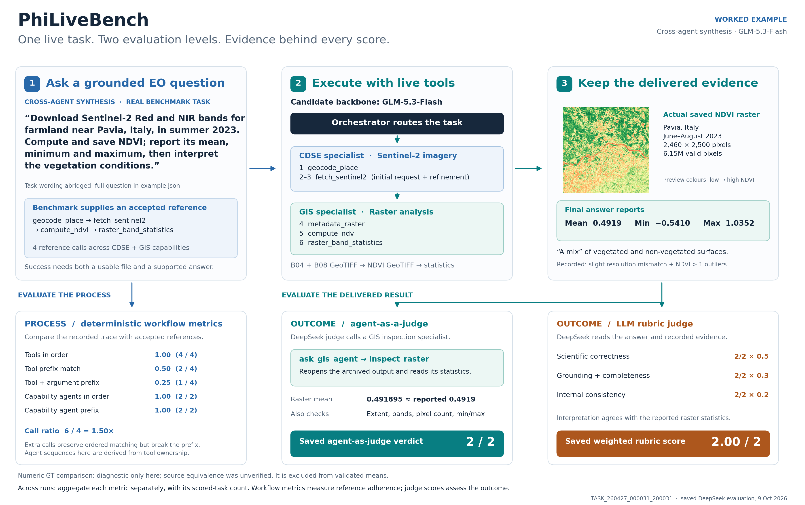
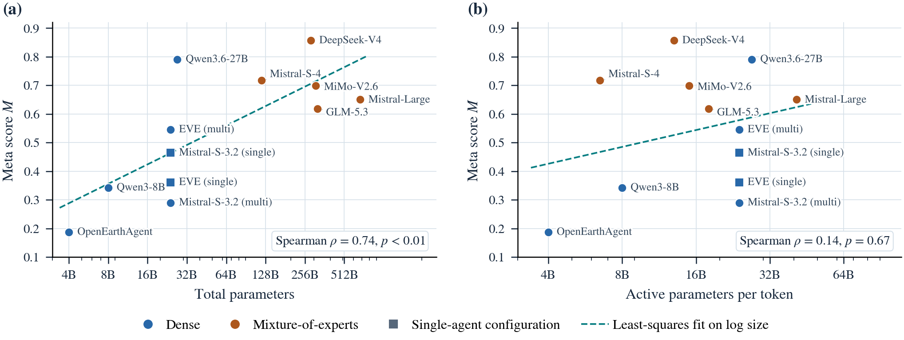

# Agentic EO Ecosystems

An Earth observation agent ecosystem and benchmark built around **EVE (Earth
Virtual Expert)**, developed by Pi School in collaboration with ESA.

The system connects language models to satellite imagery, climate data,
scientific literature and geospatial tools through the **Model Context Protocol
(MCP)**. It supports both single-agent and multi-agent execution, with recorded
candidate answers, tool traces and artifact-based evaluation.

## How it works

The default multi-agent pipeline uses a Google ADK orchestrator to route requests
to specialist agents for imagery acquisition, climate analysis, retrieval,
geospatial processing and visual interpretation.

```mermaid
graph TD

    Start([Start])
    End([End])

    Start --> Orchestrator

    Orchestrator --> CDSE[cdse_agent]
    Orchestrator --> EUMETSAT[eumetsat_agent]
    Orchestrator --> GEE[gee_agent]
    Orchestrator --> Climate[climate_agent]
    Orchestrator --> EO_STAC[eo_stac_agent]
    Orchestrator --> RAG[graph_rag_agent]
    Orchestrator --> MOOC[mooc_rag_agent]
    Orchestrator --> ArXiv[arxiv_rag_agent]
    Orchestrator --> GIS[gis_agent]
    Orchestrator --> VLM[vlm_agent]

    CDSE --> CDSE_MCP["CDSE MCP\n(Sentinel Hub imagery + geocoding)"]
    CDSE_MCP --> CDSE

    EUMETSAT --> EUMETSAT_MCP["EUMETSAT MCP\n(MTG FCI / MSG SEVIRI products)"]
    EUMETSAT_MCP --> EUMETSAT

    GEE --> GEE_MCP["GEE MCP\n(satellite image download)"]
    GEE_MCP --> GEE

    Climate --> CLIMATE_MCP["CDS MCP\n(ERA5 reanalysis)"]
    CLIMATE_MCP --> Climate

    EO_STAC --> EO_MCP["EO Dashboard MCP\n(narratives, themes, STAC collections)"]
    EO_MCP --> EO_STAC

    RAG --> GRAPHRAG_MCP["EOSS GraphRAG MCP\n(vector search + Memgraph knowledge graph)"]
    GRAPHRAG_MCP --> RAG

    MOOC --> MOOC_MCP["MOOCs MCP\n(local Qdrant, course transcripts)"]
    MOOC_MCP --> MOOC

    ArXiv --> ARXIV_MCP["ArXiv MCP\n(papers, abstracts, semantic search)"]
    ARXIV_MCP --> ArXiv

    GIS --> GIS_MCP["GIS MCP\n(geometry, raster, visualization)"]
    GIS_MCP --> GIS

    VLM --> VLM_MCP["VLM MCP\n(image loading) + Qwen3-VL"]
    VLM_MCP --> VLM

    CDSE --> Orchestrator
    EUMETSAT --> Orchestrator
    GEE --> Orchestrator
    Climate --> Orchestrator
    EO_STAC --> Orchestrator
    RAG --> Orchestrator
    MOOC --> Orchestrator
    ArXiv --> Orchestrator
    GIS --> Orchestrator
    VLM --> Orchestrator

    Orchestrator --> End
```



| Capability | Sources and tools |
|---|---|
| Satellite imagery | Copernicus Data Space, EUMETSAT and Google Earth Engine |
| Climate data | Copernicus Climate Data Store, ERA5 and ERA5-Land |
| Scientific information | EO Dashboard, ESA EO Science Strategy, MOOC content and arXiv |
| Analysis | GIS operations, raster and NetCDF processing, and image interpretation |

Available capabilities depend on the selected pipeline, configured credentials
and reachable services. The wildfire workflow also supports image analysis and
satellite acquisition planning.

## Setup

Requires **Python 3.12** and [uv](https://docs.astral.sh/uv/).

```bash
git clone https://gitlab.esa.int/PhiLab/internal/agenticeoecosystem.git
cd agenticeoecosystem
uv sync
cp .env.example .env
```

Configure `.env` for your model provider and required data services. See the
[setup guide](docs/benchmarking/candidate_reruns.md) and
[detailed server configuration](docs/project_guide.md#mcp-servers).

## Generate candidate answers

Run a model through the multi-agent pipeline:

```bash
uv run python scripts/generation/run_generate.py \
  --model EVE-Instruct --provider eve \
  --pipeline multi --label EVE-Instruct-multi \
  --tasks-file benchmark_tasks.json \
  --output-dir data/candidate_reruns/eve_multi \
  --archive-evidence
```

Use `--pipeline single` for single-agent runs. Give each model and pipeline a
separate output directory. To resume generation, load its saved results file and
add `--skip-solved`; see the [checkpoint guide](docs/benchmarking/candidate_reruns.md#resume-and-queue).

The [interactive client](src/agenticeoecosystem/client/client.py) is also
available; its architecture differs from the default multi-agent benchmark
pipeline. See [client usage](docs/project_guide.md#running-the-client).

## Benchmark and evaluation

The benchmark covers tool grounding, sequential reasoning and cross-agent
synthesis. Evaluation combines task-specific numerical and deterministic checks,
agent-as-judge inspection, GIS verification and evidence-aware rubrics.





Judge a saved candidate file:

```bash
uv run python scripts/judging/run_full_evaluation.py \
  --results-file data/candidate_reruns/eve_multi/results_EVE-Instruct-multi.json \
  --evaluator-model Mistral-Small-3.2-24B-Instruct-2506 \
  --evaluator-provider eve --evaluator-label mistral32 \
  --output-dir data/judge_runs/eve_multi_mistral32
```

The example requires that model to be served at the configured `EVE_ENDPOINT`.
Use a separate output directory for each candidate and judge. Evaluation resumes
matching checkpoints automatically. Preserve scored, unverified, unsupported and
diagnostic outcomes separately when reporting results.

Candidate-owned recomputed references can be supplied with
`--candidate-references path/to/candidate_references/model.json`. Their candidate
fingerprints and artifact hashes must match. See the
[evaluation guide](docs/evaluation/full_evaluation.md) and
[artifact verification guide](docs/evaluation/agent_judge_artifact_verification.md).

## Repository and documentation

| Location | Contents |
|---|---|
| `src/agenticeoecosystem/` | Agents, MCP servers, configuration and evaluation implementation |
| `scripts/` | Generation, judging and reference-processing entry points |
| `data/tasks/` | Current task definitions and evaluation configuration; one previous snapshot |
| `tests/` | Automated checks |
| `docs/` | Setup, evaluation protocols and development guides |

Start with the [documentation index](docs/README.md),
[script index](scripts/README.md), or
[detailed setup and development guide](docs/project_guide.md).
