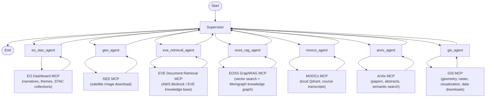

# Agentic EO Ecosystems

This project explores the integration of **EVE (Earth Virtual Expert)**, a Large Language Model specialised in **Earth Observation (EO)** and Earth Sciences, developed by Pi School in collaboration with ESA.

The primary goal is to enable EVE to connect ESA's EO platforms and data clusters, creating an **integrated ecosystem for the EO community**. This approach leverages **agentic capabilities**, allowing EVE to dynamically interact with EO tools, databases, and APIs to reason and act autonomously.

---

## Table of Contents

1. [Overview](#overview)
2. [Repository Layout](#repository-layout)
3. [Installation](#installation)
4. [Running the Client](#running-the-client)
5. [MCP Servers](#mcp-servers)
6. [Benchmarking](#benchmarking)
7. [Adding Custom Sub-agents](#adding-custom-sub-agents)

---

## Overview

This project implements a **multi-agent supervisor architecture** in which a supervisor routes each user query to one or more specialised agents. Each agent connects to an MCP server:

- **EO Dashboard agent** — browses narratives, themes, and STAC collections from the ESA/NASA/JAXA [EO Dashboard](https://eodashboard.org/)
- **GEE agent** — downloads satellite images via the Google Earth Engine Python API
- **EVE retrieval agent** — retrieves knowledge from the EVE knowledge base (AWS Bedrock)
- **EOSS GraphRAG agent** — retrieves from the ESA EO Science Strategy via GraphRAG: semantic vector search plus a Memgraph knowledge graph (science themes, science questions, strategic objectives, enabling tools, tipping points, treaties, KAOs). Backed by a remote MCP server (the `graphrag` sibling repo)
- **MOOCs agent** — semantic search over Earth Observation MOOC (online course) transcripts, backed by a local Qdrant store
- **ArXiv agent** — searches and retrieves scientific papers from ArXiv (semantic search, abstracts, full-text download)
- **GIS agent** — performs spatial analysis, raster processing, coordinate transforms, map visualization, and geospatial data downloads (ESA WorldCover, Sentinel-2 NDVI, OSM street networks, GADM boundaries)

Two further MCP servers — **EUMETSAT Data Store** (`geos_ops`) and **Climate/CDS** (`climate`) — are defined in `mcp_config.py` and load when their credentials are present, but are not yet wired to a dedicated sub-agent.

Using the **[MCP protocol](https://modelcontextprotocol.io/)**, agents can perform multi-step reasoning: for example, searching for a narrative, linking it to a STAC collection, retrieving satellite data for the relevant indicator, and computing NDVI over the area of interest.



The supervisor routes each user query to one or more specialised agents. Each agent calls its MCP server(s) and returns a synthesised result. The supervisor passes the result through to the user.

---

## Repository Layout

```
AgenticEOEcosystem/
├── agenticeoecosystem/     ← this repo
└── graphrag/               ← EOSS GraphRAG pipeline + MCP server (sibling)
```

The `graphrag` repository hosts the EOSS GraphRAG MCP server, which the client reaches over HTTP (not as a local subprocess). If `GRAPHRAG_MCP_URL` / `GRAPHRAG_AUTH_HEADER` are unset or the server is unreachable, the EOSS GraphRAG server is skipped gracefully at startup — every other server continues to work. Each optional server is registered independently, so a missing credential only disables that one tool.

```
agenticeoecosystem/
├── src/agenticeoecosystem/
│   ├── agents/         ← sub-agent definitions and system prompts
│   ├── client/         ← supervisor + interactive client
│   ├── config/         ← MCP config, credentials
│   ├── evaluation/     ← benchmarking framework
│   ├── servers/        ← MCP server implementations
│   └── utils/          ← registry, logging, helpers
├── tests/
│   └── benchmarking.py ← benchmark entry point
├── data/tasks/         ← task JSON files
└── output/ESAEOBench/   ← benchmark results (CSV, HTML, JSON)
```

---

## Installation

**Requirements:** Python 3.12+

Clone the repository:
```bash
git clone https://gitlab.esa.int/PhiLab/internal/agenticeoecosystem.git
cd agenticeoecosystem
```

### Option 1: Using uv (recommended)

Install uv if not already installed:
```bash
curl -LsSf https://astral.sh/uv/install.sh | sh
```

Install dependencies and the local package:
```bash
uv sync
```

### Option 2: Standard pip

```bash
python -m venv .venv
source .venv/bin/activate
pip install -e .
```

### Option 3: Conda

```bash
conda create -n multi_agent python=3.12
conda activate multi_agent
pip install -e .
```

---

## Running the Client

The main entry point is `src/agenticeoecosystem/client/client.py`. Startup takes a few minutes — the MCP servers need to initialise and tool discovery runs at import time. Subsequent queries in the same session are fast.

```bash
python src/agenticeoecosystem/client/client.py
```

By default the client uses **EVE** as the LLM backend. To override:

```bash
python src/agenticeoecosystem/client/client.py --model <model_name> --provider <provider>
```

Once loaded, the client enters an interactive loop. Type your query and press Enter. Type `quit` to exit.

```
Query (or 'quit' to exit): Is there a narrative about COVID-19?
```

Each session writes a timestamped log to `logs/client_YYYYMMDD_HHMMSS.log`.

---

## MCP Servers

The client registers up to nine MCP servers at startup, configured in [`mcp_config.py`](src/agenticeoecosystem/config/mcp_config.py). Seven back a dedicated sub-agent (EO Dashboard, GEE, EVE retrieval, EOSS GraphRAG, MOOCs, ArXiv, GIS); two more (EUMETSAT Data Store and Climate/CDS) load their tools when credentials are present but are not yet exposed through a sub-agent. Each server is registered independently — if its dependency or credential is missing, that one server is skipped with a warning and the client still starts.

### EO Dashboard

No setup required. The server fetches data from public ESA EO Dashboard endpoints and exposes tools for browsing narratives, themes, and STAC collections. It starts automatically as a stdio subprocess with the client.

**Exposing it externally** (e.g. as an MCP connector on the ASK ESA / Mistral platform): run it in streamable-HTTP mode instead, via the NEOHPC gateway — same pattern as EOSS GraphRAG below.

```bash
cd agenticeoecosystem
screen -dmS eodashboard-http bash -c 'source .venv/bin/activate && python src/agenticeoecosystem/servers/EOdashboard/eodashboard_server.py --transport streamable-http --port 13000; exec bash'
```

Connector URL: `https://phi-gateway.tce.ples.dedyn.io/neohpc-phi-gpu-01/13000/mcp`, same gateway Basic Auth credential as GraphRAG below. `--transport` defaults to `stdio`, so the local client's usage (`mcp_config.py`) is unaffected by running this in parallel.

### Google Earth Engine (GEE)

Enables satellite image downloads via the [Earth Engine Python API](https://developers.google.com/earth-engine/guides/python_install). One-time setup:

1. **Create a Google account** and sign up for [Google Earth Engine](https://earthengine.google.com/). Academic/research access is free.
2. **Create a Google Cloud project** at [console.cloud.google.com](https://console.cloud.google.com) and note the **Project ID**.
3. **Enable the Earth Engine API**: APIs & Services → Enable APIs → search *Earth Engine API*.
4. **Create a service account**: IAM & Admin → Service Accounts → Create. Assign the role *Earth Engine Resource Writer*.
5. **Register with Earth Engine**: [code.earthengine.google.com/register](https://code.earthengine.google.com/register), select your Cloud project, complete registration.
6. **Download a JSON key**: Service Accounts → your account → Keys → Add Key → JSON.
7. Add to `.env`:

```env
GEE_PROJECT=your-gcp-project-id
GEE_SERVICE_ACCOUNT=your-service-account@your-project.iam.gserviceaccount.com
GEE_PRIVATE_KEY_PATH=/absolute/path/to/your-key.json
```

### EVE Knowledge Retrieval

Provides retrieval-augmented access to the EVE knowledge base. Requires OAuth2 credentials:

```env
EVE_RETRIEVAL_CLIENT_ID=your-client-id
EVE_RETRIEVAL_CLIENT_SECRET=your-client-secret
```

Contact the EVE platform team to obtain these. If not set, the server is skipped and `get_eve_knowledge` will be unavailable.

### EO Science Strategy (EOSS GraphRAG)

Provides GraphRAG retrieval over the **ESA Earth Observation Science Strategy** — combining semantic vector search with a **Memgraph** knowledge graph that links document chunks to domain concepts (science themes, science questions, strategic objectives, enabling tools, tipping points, treaties, and KAOs). It exposes three tools: `search_eoss` (natural-language GraphRAG search), `query_ontology` (read-only Cypher), and `list_ontology_nodes` (enumerate nodes by label).

Unlike the other servers, this one runs as a **standalone HTTP MCP server** in the `graphrag` sibling repo, and the client connects to it remotely. Point the client at it via `.env`:

```env
GRAPHRAG_MCP_URL=https://phi-gateway.tce.ples.dedyn.io/neohpc-phi-gpu-01/12000/mcp
GRAPHRAG_AUTH_HEADER=Basic <base64(user:pass)>
```

`GRAPHRAG_MCP_URL` is the gateway URL of the running GraphRAG server (must end in `/mcp`). `GRAPHRAG_AUTH_HEADER` is the full `Authorization` header value; use `graphrag/gen_auth_header.py` to generate it.

**Start the server** (from the `graphrag` repo, e.g. inside a `screen` session), after loading the Memgraph graph via the numbered pipeline scripts (`00_schema.py` … `03_link_chunks.py`):

```bash
uv run python 05_mcp_server.py            # listens on 0.0.0.0:12000
```

If the server is unreachable or the env vars are unset, the EOSS GraphRAG tools are skipped and the client starts without them.

### EO MOOCs

Provides semantic search over Earth Observation MOOC (online course) transcripts via the `search_moocs` tool. The server uses a **local, file-based Qdrant store** bundled in `src/agenticeoecosystem/servers/moocs/qdrant_storage/` — no cloud service or credentials required. On first launch it embeds and indexes the bundled `data/MOOC.jsonl`; subsequent starts reuse the existing collection. It starts automatically as a stdio subprocess with the client.

**Exposing it externally** (e.g. as an MCP connector on the ASK ESA / Mistral platform): run it in HTTP mode via the NEOHPC gateway. The local Qdrant store takes an exclusive file lock, so a second process can't share the same `qdrant_storage/` directory as the stdio instance above — point it at a separate `--storage-path` instead (auto-ingested on first run, ~30s; instant afterwards):

```bash
cd agenticeoecosystem
screen -dmS moocs-http bash -c 'source .venv/bin/activate && python src/agenticeoecosystem/servers/moocs/server.py --transport http --port 14000 --storage-path src/agenticeoecosystem/servers/moocs/qdrant_storage_http; exec bash'
```

Connector URL: `https://phi-gateway.tce.ples.dedyn.io/neohpc-phi-gpu-01/14000/mcp`, same gateway Basic Auth credential as EOSS GraphRAG above.

### ArXiv

Provides access to scientific papers via the [arxiv-mcp-server](https://github.com/blazickjp/arxiv-mcp-server). No API key required. The server runs in an isolated uv tool environment.

Pre-install (one-time, speeds up the first connection):
```bash
uv tool install arxiv-mcp-server
```

Papers fetched during a session are cached in `src/agenticeoecosystem/servers/arxiv_papers/`. Available tools include `search_papers`, `get_abstract`, `download_paper`, `semantic_search`, `citation_graph`, and `watch_topic`.

### GIS Analysis

Provides 90+ spatial tools via [gis-mcp](https://github.com/mahdin75/gis-mcp): geometry operations (Shapely), vector file processing (GeoPandas), raster analysis (Rasterio), spatial statistics (PySAL), map visualisation (Folium), and geospatial data downloads (ESA WorldCover, Sentinel-2 NDVI via Planetary Computer, OSM street networks, GADM administrative boundaries).

The server runs in an isolated uv tool environment to avoid numpy version conflicts with other dependencies. Install once:
```bash
uv tool install "gis-mcp[visualize]"
```

Optional extras (install separately if needed):
```bash
uv tool install "gis-mcp[administrative-boundaries]"   # GADM boundary downloads
uv tool install "gis-mcp[climate]"                     # ERA5 climate data (requires Copernicus account)
```

No additional `.env` variables are required for the core tools.

### EUMETSAT Data Store (optional)

Registered when EUMETSAT Data Store credentials are present. Loads its tools but is **not yet wired to a sub-agent**, so it is not reachable from the supervisor.

```env
EUMETSAT_CONSUMER_KEY=your-consumer-key
EUMETSAT_CONSUMER_SECRET=your-consumer-secret
```

### Climate / CDS (optional)

Registered when Copernicus Climate Data Store credentials are present. As with EUMETSAT, its tools load but are **not yet exposed through a sub-agent**.

```env
CDS_URL=https://cds.climate.copernicus.eu/api
CDS_KEY=your-cds-api-key
```

---

## Benchmarking

The evaluation framework lives in `src/agenticeoecosystem/evaluation/` and the entry point is `tests/benchmarking.py`. It runs a set of EO tasks through the agent pipeline, scores the results with one or more LLM-as-judge models, and produces a comparison table across generator models.

### Pipeline

For each generator model:
1. **Generate** — run every task through the agent pipeline and record the tool-call sequence (Solution)
2. **Evaluate** — for each evaluator model, compare the generated solution against the reference solution and assign a score (0 = no match, 1 = partial, 2 = full match)
3. **Save** — write per-model results to `output/ESAEOBench/` and a summary table as CSV and HTML

### Task format

Tasks are stored as JSON files in `data/tasks/` and loaded as a `TaskSet`:

```python
from agenticeoecosystem.evaluation.dataclasses import TaskSet

tasks = TaskSet.read_from_file("benchmark_tasks.json")
```

Each `Task` has:
- `task_text` — the natural-language query
- `task_labels` — one or more of: `Tool Grounding`, `Sequential Reasoning`, `Cross-agent Synthesis`, `Scope Awareness`
- `reference_solutions` — list of acceptable tool-call sequences
- `generated_solution` — populated after the pipeline runs
- `evaluator_scores` / `evaluator_reasoning` — populated after LLM-as-judge runs

Useful selection helpers:
```python
tasks.select_by_ids(["TASK_...", "TASK_..."])   # by ID
tasks.select_by_labels(["Tool Grounding"])       # by category
tasks.subset("Sequential Reasoning", n=5)        # single category, capped
tasks.sample_stratified(20)                      # stratified random sample
```

### Model registry

Generator and evaluator models are defined in [`src/agenticeoecosystem/utils/registry.py`](src/agenticeoecosystem/utils/registry.py). Models that need a local vLLM server are listed in `MODEL_REGISTRY`:

| Key | Model | Gated |
|---|---|---|
| `qwen3-14b` | Qwen/Qwen3-14B | free |
| `qwen2.5-14b` | Qwen/Qwen2.5-14B-Instruct | free |
| `qwen3-30b-moe` | Qwen/Qwen3-30B-A3B | free |
| `deepseek-r1-14b` | deepseek-ai/DeepSeek-R1-Distill-Qwen-14B | free |
| `phi4-mini` | microsoft/Phi-4-mini-instruct | free |
| `nemotron-2-12b` | nvidia/NVIDIA-Nemotron-Nano-12B-v2 | free |
| `gemma3-12b` | google/gemma-3-12b-it | gated |
| `gemma4-31b` | google/gemma-4-31B-it | free |
| `qwen3.6-27b` | Qwen/Qwen3.6-27B | free |
| `qwen3.6-35b-a3b` | Qwen/Qwen3.6-35B-A3B (MoE, 3B active) | free |
| `mistral-small-24b` | mistralai/Mistral-Small-3.1-24B-Instruct-2503 | gated |
| `llama3.1-8b` | meta-llama/Llama-3.1-8B-Instruct | gated |
| `llama3.2-3b` | meta-llama/Llama-3.2-3B-Instruct | gated |

Gated models require accepting the licence on huggingface.co and setting `HF_TOKEN` in `.env`.

Download models before running (skips if already cached):

```python
from agenticeoecosystem.utils.registry import download_model, list_downloaded

list_downloaded()                          # show download status for all models
download_model("qwen3-14b")               # free model
download_model("gemma3-12b")              # gated — needs HF_TOKEN
```

### Running a single generator model (CLI)

For a one-off run against a single model — e.g. comparing a new candidate LLM against EVE — use `scripts/run_generate.py` directly instead of editing `tests/benchmarking.py`. Each invocation is a fresh process: for `--provider vllm` it launches its own vLLM server (reusing one already serving the same model if present) and tears it down on exit unless `--keep-vllm-alive` is passed; for `--provider eve` it talks to `EVE_ENDPOINT` (`.env`) directly and never touches vLLM.

```bash
# EVE-Instruct — provider="eve", no vLLM server launched by this process
uv run python scripts/run_generate.py \
  --label       "EVE-Instruct" \
  --model       "EVE-Instruct" \
  --provider    "eve" \
  --pipeline    "multi" \
  --tasks-file  benchmark_tasks.json \
  --task-labels "Tool Grounding,Sequential Reasoning,Cross-agent Synthesis,Scope Awareness" \
  --output-dir  "output/ESAEOBench/run_$(date +%Y%m%d_%H%M%S)" \
  --task-timeout 2400

# A local candidate model — provider="vllm", auto-launches on port 8000
uv run python scripts/run_generate.py \
  --label       "Qwen3.6-27B" \
  --model       "qwen3.6-27b" \
  --provider    "vllm" \
  --pipeline    "multi" \
  --tasks-file  benchmark_tasks.json \
  --task-labels "Tool Grounding,Sequential Reasoning,Cross-agent Synthesis,Scope Awareness" \
  --output-dir  "output/ESAEOBench/run_$(date +%Y%m%d_%H%M%S)" \
  --vllm-startup-timeout 1800 \
  --task-timeout 2400
```

Key flags:

| Flag | Description |
|---|---|
| `--label` | Human-readable name, used in the output filename (`results_<label>.json`) |
| `--model` | Registry key (for `vllm`) or model identifier (for `eve`) |
| `--provider` | `eve`, `vllm`, `openai`, … |
| `--pipeline` | `multi` (google-adk orchestrator), `single` (one LangGraph agent), or `multi_legacy` |
| `--tasks-file` | One or more task JSON filenames from `data/tasks/` (merged if multiple) |
| `--task-labels` / `--task-ids` | Filter to specific categories or task IDs |
| `--output-dir` | Directory for `results_<label>.json` |
| `--vllm-startup-timeout` | Seconds to wait for the vLLM server's `/health` (only relevant for `--provider vllm`) |
| `--task-timeout` | Max wall-clock seconds per task before it's abandoned and the run moves on |
| `--skip-solved` | Skip tasks that already have a `generated_solution` in the loaded file |
| `--keep-vllm-alive` | Don't tear down the vLLM server this process launched, so a following call for the same model can reuse it |

**Note:** the `MODEL_REGISTRY` in `registry.py` has no entry for EVE — always use `--provider eve` for it, never `--provider vllm`.

### Running a comparison

Edit `tests/benchmarking.py` to configure which models and tasks to run:

```python
from agenticeoecosystem.evaluation.model_comparison import ModelRun, run_comparison
from agenticeoecosystem.evaluation.dataclasses import TaskSet
from agenticeoecosystem.utils.logging import setup_logging

setup_logging(log_file="benchmarking")   # → logs/benchmarking_YYYYMMDD_HHMMSS.log

tasks = TaskSet.read_from_file("benchmark_tasks.json")
selected = tasks.select_by_ids(["TASK_...", "TASK_..."])

runs = [
    # External API — always available, no vLLM needed
    ModelRun(label="EVE-Instruct", model="EVE-Instruct", provider="eve"),

    # Local models via vLLM — launched and shut down automatically
    ModelRun(label="Qwen3-14B",  model="qwen3-14b",  provider="vllm",
             launch_vllm=True, vllm_startup_timeout=600),
    ModelRun(label="Gemma3-12B", model="gemma3-12b", provider="vllm",
             launch_vllm=True, vllm_startup_timeout=600),
]

evaluators = [
    ModelRun(label="Nemotron-2-12B", model="nemotron-2-12b", provider="vllm",
             launch_vllm=True, vllm_startup_timeout=600),
]

df = run_comparison(runs, selected, evaluators=evaluators)
print(df.to_string())
```

`ModelRun` parameters:

| Parameter | Description |
|---|---|
| `label` | Human-readable name used in output columns |
| `model` | Registry key (vLLM) or model identifier (eve, ollama, …) |
| `provider` | `"eve"`, `"vllm"`, `"ollama"`, `"openai"`, `"custom"` |
| `temperature` | Sampling temperature (default `0.0`) |
| `launch_vllm` | Start/stop a local vLLM server automatically |
| `vllm_startup_timeout` | Seconds to wait for `/health` (default `600`) |

If a vLLM server is already running and serving the correct model, `launch_vllm=True` will reuse it instead of restarting.

Run from the project root:
```bash
python tests/benchmarking.py
```

### Outputs

Each full `benchmark.sh` run writes to a timestamped subdirectory so results from different runs never overwrite each other:

| File | Description |
|---|---|
| `output/ESAEOBench/run_YYYYMMDD_HHMMSS/results_<Label>.json` | Per-model task results with scores |
| `output/ESAEOBench/run_YYYYMMDD_HHMMSS/model_comparison.csv` | Summary table (generators × evaluators) |
| `output/ESAEOBench/run_YYYYMMDD_HHMMSS/model_comparison.html` | Same table as HTML |
| `logs/benchmarking_YYYYMMDD_HHMMSS.log` | Full run log |

To regenerate the comparison table from any archived run:
```bash
python scripts/build_table.py --output-dir output/ESAEOBench/run_YYYYMMDD_HHMMSS
```

### Multi-model bash orchestration

For full multi-model runs with per-process GPU isolation (required on a single GPU to avoid vLLM CUDA memory leaks), use the bash orchestrator:

```bash
bash scripts/benchmark.sh            # all runnable task categories (default)
bash scripts/benchmark.sh --subset   # curated 9-task subset only
```

Each generator model runs in its own Python subprocess. Between runs, any orphaned vLLM workers are hard-killed via `pkill`. Evaluator models (Nemotron-2-12B, Gemma3-12B, Qwen3-14B) score every generator's results afterwards.

Edit `scripts/benchmark.sh` to add or remove generator and evaluator models.

### Smoke test

To run a quick sanity check on a small subset before the full run:

```python
df = run_comparison(
    runs, tasks, evaluators=evaluators,
    smoke_test_labels=["Tool Grounding"],
    smoke_test_n=2,
)
```

This filters to 2 tasks with the `Tool Grounding` label and appends `_smoke` to all output filenames.

---

## Adding Custom Sub-agents

### Creating the MCP tools

Follow the example server at [`src/agenticeoecosystem/servers/example/stdio_localserver/example_server.py`](src/agenticeoecosystem/servers/example/stdio_localserver/example_server.py) or any other server in the [`servers/`](src/agenticeoecosystem/servers) folder. Once created, add an entry to `get_mcp_servers()` in [`mcp_config.py`](src/agenticeoecosystem/config/mcp_config.py):

```python
"example": {
    "transport": "stdio",
    "command": "python",
    "args": [f"{ROOT_DIR}/src/agenticeoecosystem/servers/example/stdio_localserver/example_server.py"],
},
```

See the [MCP documentation](https://modelcontextprotocol.io/docs/develop/build-server) for more on building MCP servers.

### Creating the sub-agent

Declare the agent:

```python
my_custom_agent = create_agent(
    model,
    tools=[t for t in mcp_tools if t.name in ("my_tool_a", "my_tool_b")],
    system_prompt="..."
)
```

Wrap it as a tool for the supervisor:

```python
@tool
async def my_agent_as_tool(request: str) -> str:
    """Describe the functionality of the agent."""
    logger.info("[TOOL CALL] my_agent_as_tool: %s", request)
    result = await my_custom_agent.ainvoke({"messages": [{"role": "user", "content": request}]})
    text_output = result["messages"][-1].text
    if isinstance(text_output, tuple):
        text_output = " ".join(str(t) for t in text_output)
    return str(text_output)
```

Register it with the supervisor:

```python
supervisor_agent = create_agent(
    model,
    tools=[
        get_eo_stac_data, get_gee_data, get_eve_knowledge,
        get_eossgraphrag_context, get_arxiv_data, get_gis_analysis,
        my_agent_as_tool,
    ],
    system_prompt=(
        "You are a routing agent. "
        "You can get data from EO Dashboards, Google Earth Engine, "
        "the EVE knowledge base, the ESA EO Science Strategy knowledge base, "
        "ArXiv scientific papers, the GIS analysis server, "
        "and <describe your custom agent here>. "
        "Break down user requests into appropriate tool calls and coordinate the results. "
        "Return tool results directly to the user without summarising."
    )
)
```

If you run into any trouble, feel free to open an issue.
